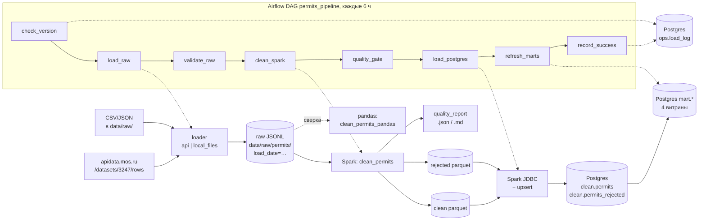

# mos-data-pipeline

[](https://github.com/USER/REPO/actions/workflows/ci.yml)

## Цель

Пайплайн данных на открытом наборе [data.mos.ru](https://data.mos.ru) **3247** — пропуска
для грузового автотранспорта в зоны ограничения движения (МКАД, ТТК, СК). Проект —
ступень подготовки к стажировке ML-инженера: загрузка, очистка на PySpark и pandas,
PostgreSQL, SQL-витрины и оркестрация в Airflow.

## Статус

| этап | статус |
|---|---|
| Загрузчик: API apidata.mos.ru и локальные CSV/JSON → raw | готово |
| Отчёт по raw-партиции (`scripts/raw_report.py`) | готово |
| Очистка raw → clean/rejected: PySpark и pandas, отчёт о качестве | готово |
| PostgreSQL 16 и SQL-витрины: загрузка clean/rejected, 4 витрины, проверки | готово |
| Airflow 3.3.2: DAG `permits_pipeline`, LocalExecutor, прогон на готовой партиции (`skip_load`) | готово |
| Прогон DAG с загрузкой из API (без `skip_load`) | не выполнялся |
| CI (GitHub Actions): ruff и pytest с Postgres | workflow написан и проверен локально; на GitHub не запускался |

## Источник данных

Набор **3247** «Пропуска, предоставляющие право на въезд и передвижение грузового
автотранспорта в зонах ограничения его движения на территории города Москвы» —
[data.mos.ru/opendata/3247](https://data.mos.ru/opendata/3247), ведомство: Департамент транспорта
и развития дорожно-транспортной инфраструктуры города Москвы (по карточке набора в API).
Данные открытые, загружаются через [apidata.mos.ru](https://apidata.mos.ru) с личным ключом.

Условия использования определяет портал. Текст лицензии найти не удалось: страница набора
отрисовывается JavaScript, в её HTML, в карточке набора из API и в поиске сведений о лицензии нет.
Перед публикацией данных или выводов по ним условия нужно проверить на странице набора в браузере.
Сами данные в репозиторий не входят (`data/` в `.gitignore`).

## Архитектура



Все данные лежат в `data/` (не в git), партиция одной загрузки — `load_date=YYYY-MM-DD`:

| слой | путь | формат |
|---|---|---|
| raw | `data/raw/permits/load_date=…/page_NNNNNN.jsonl` + `_manifest.json` | строки как их отдаёт API, по странице на файл |
| clean | `data/clean/permits/load_date=…/valid_from_year=YYYY/` | parquet, партиции по году ValidFrom, флаги качества |
| rejected | `data/rejected/permits/load_date=…/` | parquet, исходные значения и колонка `reason` |
| отчёт | `data/quality/permits/load_date=…/quality_report.json`, `.md` | числа строк, причины отказа, флаги |

Результат pandas-варианта очистки пишется так же, но под `data/pandas/`.

PostgreSQL (контейнер из `docker-compose.yml`):

| объект | что это |
|---|---|
| `clean.permits` | clean, первичный ключ `global_id`, типы date/int/boolean, `source_load_date` |
| `clean.permits_rejected` | rejected с причиной `reason` |
| `clean.*_stage` | промежуточные UNLOGGED-таблицы для Spark JDBC, после загрузки пусты |
| `mart.daily_permits` | по дате начала действия и зоне: пропуска, аннулированные (CancelDate заполнена), скользящее среднее за 7 дней, накопительная сумма |
| `mart.active_permits_daily` | действующие пропуска на каждую дату по зоне: ValidFrom ≤ d ≤ ValidTo и CancelDate пуста или не раньше d |
| `mart.cancel_rate_by_zone_month` | доля аннулированных среди начавших действовать в месяце, по зоне |
| `mart.validity_stats` | длительность ValidTo − ValidFrom: медиана, перцентили, 5 самых частых значений |
| `ops.load_log` | успешные прогоны DAG: одна строка на load_date (версия набора, /count, строки raw/clean/rejected) |

Витрины — материализованные представления, пересобираются целиком из `sql/marts/*.sql`.
Метаданные Airflow — в отдельной базе `airflow` того же контейнера Postgres, у пользователя
`airflow` нет доступа к базе проекта.

Docker Compose:

| сервис | лимит памяти | что делает |
|---|---|---|
| `postgres` | 1 ГБ | данные проекта и метабаза Airflow, порт 5432 только на 127.0.0.1 |
| `airflow-db-init` | 128 МБ | один раз: база и пользователь `airflow` |
| `airflow-init` | 1 ГБ | один раз: миграции метабазы, администратор |
| `airflow-apiserver` | 1 ГБ | UI и API, порт 8080 только на 127.0.0.1 |
| `airflow-scheduler` | 3,5 ГБ | планировщик; LocalExecutor выполняет задачи здесь (Spark `driver.memory 2g`) |
| `airflow-dag-processor` | 768 МБ | разбор DAG |

Образ `mos-airflow:3.3.2` (`docker/airflow/Dockerfile`): официальный `apache/airflow:3.3.2-python3.11`,
Airflow по constraints, Java 17 (`openjdk-17-jre-headless`) и отдельный venv проекта
`/opt/project-venv` из `requirements.txt` (pyspark 3.5.9 и остальное — те же версии, что в локальных тестах).
Задачи DAG запускают модули проекта отдельными процессами из этого venv. Код (`src`, `sql`, `dags`)
и `data/` подключаются томами.

Код:

```
src/loader/      загрузчик (python -m loader)
src/spark_jobs/  очистка (clean_permits) и загрузка в Postgres (load_postgres) на PySpark
src/cleaning/    общие правила очистки и вариант на pandas
src/db/          настройки подключения к Postgres, выполнение SQL из sql/
src/pipeline/    шаги DAG: check-version, validate-raw, quality-gate, record-success
sql/ddl/         схемы clean, mart, ops; таблицы, индекс
sql/load/        upsert из *_stage в clean.permits и clean.permits_rejected
sql/marts/       витрины
dags/            permits_pipeline.py
docker/airflow/  Dockerfile образа Airflow
scripts/         raw_report.py - отчёт по raw-партиции; check_postgres.py - сверка Postgres с parquet и pandas
tests/           pytest; tests/dags - тесты DAG (запускаются в контейнере Airflow)
docs/            пока пуст
```

ValidFrom везде — дата начала действия пропуска; дата выдачи в наборе отсутствует,
и там, где нужна дата выдачи, ValidFrom используется только как её приближение.

## Быстрый старт

Проверено на Python 3.11.13, OpenJDK 17 (Java нужна для PySpark) и Docker Desktop 29.1
(PostgreSQL и Airflow; памяти Docker было 6,6 ГБ).

```bash
uv venv .venv --python 3.11
uv pip install --python .venv/bin/python -r requirements-dev.txt

cp .env.example .env        # вписать MOS_API_KEY и POSTGRES_* (пароль - только в .env)
set -a; . ./.env; set +a    # загрузчик берёт ключ из окружения
export PYTHONPATH=src       # команды ниже - из корня проекта
```

Загрузчик:

```bash
# полная загрузка через API; партиция load_date = сегодня (или --load-date YYYY-MM-DD)
.venv/bin/python -m loader --mode api

# пробный прогон: первые 3 страницы
.venv/bin/python -m loader --mode api --max-pages 3

# продолжить упавшую загрузку, если версия набора и max_pages не изменились
.venv/bin/python -m loader --mode api --resume

# допустимая нехватка строк относительно /count (иначе MOS_COUNT_TOLERANCE, по умолчанию 0)
.venv/bin/python -m loader --mode api --count-tolerance 10

# локальные выгрузки: файлы .csv/.json, положенные прямо в data/raw/
.venv/bin/python -m loader --mode local_files
```

Таймауты API настраиваются переменными `MOS_CONNECT_TIMEOUT` (10 с),
`MOS_READ_TIMEOUT` (60 с) и `MOS_PAGE_DEADLINE` (180 с на страницу целиком).

Отчёт по raw-партиции (Markdown в stdout; повторы запросов — из лога загрузки, если он указан):

```bash
.venv/bin/python scripts/raw_report.py --load-date 2026-10-21 --log ~/mos-pipeline-logs/<лог>.log
```

Очистка:

```bash
.venv/bin/python -m spark_jobs.clean_permits --load-date 2026-10-21
.venv/bin/python -m cleaning.clean_permits_pandas --load-date 2026-10-21   # пишет в data/pandas/
```

PostgreSQL и Airflow (секреты — только в `.env`: `POSTGRES_*`, `AIRFLOW_*`, `MOS_API_KEY`):

```bash
docker compose up -d --wait    # при первом запуске собирает образ mos-airflow:3.3.2 (~3 мин)
```

UI Airflow: http://127.0.0.1:8080, логин и пароль — `AIRFLOW_ADMIN_USER` / `AIRFLOW_ADMIN_PASSWORD`.
DAG `permits_pipeline` создаётся на паузе. Включить расписание (каждые 6 ч по Москве):

```bash
docker compose exec airflow-scheduler airflow dags unpause permits_pipeline
```

Запуск на уже лежащей партиции, без загрузки из API:

```bash
# через планировщик (DAG должен быть включён: у DAG на паузе запуск ждёт)
docker compose exec airflow-scheduler airflow dags trigger permits_pipeline \
  -c '{"load_date": "2026-10-21", "skip_load": true}'
# или сразу в консоли, без планировщика
docker compose exec airflow-scheduler airflow dags test permits_pipeline 2026-10-21 \
  -c '{"load_date": "2026-10-21", "skip_load": true}'
```

`MOS_API_KEY` передаётся в контейнер планировщика как Docker secret и попадает только в процессы
задач, которые обращаются к API (`check_version` без `skip_load` и `load_raw`).

Те же шаги без Airflow, из локального venv:

```bash
.venv/bin/python -m spark_jobs.load_postgres --load-date 2026-10-21   # DDL + Spark JDBC + upsert
.venv/bin/python -m db.sql_files marts                               # пересборка витрин
.venv/bin/python scripts/check_postgres.py --load-date 2026-10-21    # сверка с parquet и pandas
```

JDBC-драйвер `org.postgresql:postgresql:42.7.14` Spark скачивает сам при первом запуске
(версия — в `src/db/settings.py`, переопределяется `POSTGRES_JDBC_VERSION`).

Тесты (ключ API не нужен; тесты очистки поднимают локальный Spark; тесты Postgres
работают в отдельной базе `<POSTGRES_DB>_test` и пропускаются, если Postgres не запущен):

```bash
.venv/bin/python -m pytest
# тесты DAG - в контейнере Airflow (локально пропускаются)
docker compose exec -w /opt/project airflow-scheduler python -m pytest tests/dags -p no:cacheprovider
```

Тестам не нужен настоящий `MOS_API_KEY` и выход в сеть: фикстура в `tests/conftest.py`
убирает ключ из окружения и запрещает Python-соединения не на localhost (`tests/test_isolation.py`).
С `PG_TESTS_REQUIRED=1` тесты Postgres падают, а не пропускаются, если базы нет.

Линтер и CI (`.github/workflows/ci.yml`: задачи `lint` и `test`, Python 3.11, Java 17,
сервис `postgres:16-alpine`; `tests/dags` в CI не запускаются — им нужен образ Airflow):

```bash
.venv/bin/ruff check .   # правила E, F, I; длина строки 120, E501 в tests/ отключён
```

## Результаты: load_date=2026-10-21, версия набора 1.6280

**Загрузка** (`_manifest.json`, лог загрузки):

| показатель | значение |
|---|---|
| страниц | 984 |
| время | 1 ч 33 мин (00:13:31 → 01:46:28 МСК) |
| строк | 983 505 |
| /count | 983 506 |
| нехватка / допуск | 1 / 10 |
| повторов запросов | 25: 21 × HTTP 500, 2 × HTTP 502, 1 обрыв соединения, 1 таймаут чтения |

**Очистка** (`quality_report.json`; Spark и pandas дали одинаковые числа и одинаковую
sha256 отсортированных global_id в clean):

| показатель | строк |
|---|---|
| raw | 983 505 |
| clean | 983 146 |
| rejected | 359 |
| — duplicate_id | 345 |
| — invalid_validity_range | 14 |
| — unparseable_date, unknown_zone, unknown_status | 0 |
| флаг cancelled_before_start | 7 266 |
| флаг status_cancel_mismatch | 27 |
| флаг id_conflict | 0 |

Инвариант raw = clean + rejected выполняется (задача очистки падает, если нет).

**Spark против pandas** (замер 2026-10-21 на этой партиции: 3 запуска каждого
поочерёдно, медиана; память — пик суммарного RSS процесса и его дочерних процессов,
у Spark включая JVM; старт SparkSession — отдельно):

| движок | время, с | пик памяти, МБ | старт SparkSession, с |
|---|---|---|---|
| PySpark 3.5.9, `local[*]`, 16 ядер | 17,33 | 3 079 | 1,73 |
| pandas 2.3.3 | 11,45 | 1 428 | — |

**PostgreSQL** (`load_postgres`, `check_postgres.py`):

| показатель | значение |
|---|---|
| строк в `clean.permits` | 983 146 (= parquet clean; sha256 отсортированных global_id совпадает) |
| строк в `clean.permits_rejected` | 359 (= parquet rejected) |
| первая загрузка | вставлено 983 146 + 359, 40 с вместе со стартом Spark |
| повторная загрузка | вставлено 0, обновлено 0; md5 всех строк обеих таблиц не изменился |
| сверка витрин с pandas | 23 проверки из 23 сошлись точно (каждая строка daily_permits и cancel_rate_by_zone_month, весь ряд active_permits_daily и перебор по определению на 120 датах, все поля validity_stats) |
| строк в витринах | daily_permits 10 317, active_permits_daily 15 765, cancel_rate_by_zone_month 330, validity_stats 4 |

**EXPLAIN ANALYZE** запроса «daily_permits за сентябрь 2026»
(`WHERE valid_from BETWEEN '2026-09-01' AND '2026-09-30' GROUP BY valid_from, zone`;
3 запуска, медиана, после `VACUUM ANALYZE`):

| | план | буферов | время, мс |
|---|---|---|---|
| без индекса | Parallel Seq Scan, отброшено фильтром ~952 тыс. строк | 13 301 | 82,21 |
| с индексом `(valid_from, zone) INCLUDE (cancel_date)` | Index Only Scan, Heap Fetches 0 | 154 | 13,27 |

Размер индекса 36 МБ, таблицы 104 МБ. Полная пересборка витрин читает всю таблицу, индекс
ей не нужен.

**Airflow** (`airflow dags test permits_pipeline 2026-10-21`, `skip_load=true`, в контейнере
планировщика с лимитом 3,5 ГБ):

| задача | состояние | время, с |
|---|---|---|
| check_version | success (версия 1.6280 из манифеста, в `ops.load_log` пусто → дальше) | 3,8 |
| load_raw | skipped (`skip_load`) | 0,0 |
| validate_raw | success (983 505 строк, 984 страницы, нехватка 1 при допуске 2) | 2,3 |
| clean_spark | success (clean 983 146, rejected 359; старт SparkSession 4,4 с) | 22,8 |
| quality_gate | success (доля rejected 0,0365 %) | 0,3 |
| load_postgres | success (вставлено 0, обновлено 0) | 32,3 |
| refresh_marts | success | 7,9 |
| record_success | success (строка в `ops.load_log`) | 0,4 |

Весь прогон — 84 с, пик памяти контейнера планировщика 2,53 ГБ. Повторный прогон с теми же
параметрами: `check_version` вернул `proceed: false` (версия 1.6280 уже успешно загружена),
остальные 7 задач пропущены, 12 с. Значение `MOS_API_KEY` не найдено ни в логах Airflow, ни в
`docker logs` сервисов, ни в метабазе, ни в `docker inspect` контейнеров (проверено поиском по
значению, в том числе после запуска `check_version` с обращением к API).

Образ `mos-airflow:3.3.2` — 4,73 ГБ: базовый образ 3,24 ГБ, Java 17 — 216 МБ, venv проекта — 753 МБ.

**Полный прогон DAG** (с `load_raw` из API, без `skip_load`) не выполнялся. Отдельно проверена
только задача `check_version` с обращением к API (`airflow tasks test`): версия 1.6282, `/count` 984 234.

**Линтер и тесты** (локально, теми же командами, что в CI, с отдельным `postgres:16-alpine`):
`pytest` — 112 тестов прошли; `ruff check .` — 17 замечаний E501 (строки длиннее 120 в
`scripts/raw_report.py`, `src/pipeline/ops.py`, `src/spark_jobs/clean_permits.py`, `src/db/settings.py`),
поэтому задача `lint` пока завершится с ошибкой.

## Особенности источника и ограничения

- Набор обновляется несколько раз в сутки: 20.10.2026 загрузчик видел версии 1.6278,
  1.6279 и 1.6280. Загрузка, во время которой версия сменилась, перезапускается.
- Пагинация — `$skip`/`$top` без `$orderby`: порядок строк задаёт API.
- `$top` не больше 1000 (на большее API отвечает 400).
- Получено на 1 строку меньше, чем сообщает `/count`; причина не выяснена.
- 126 групп строк с одинаковым ID (345 лишних строк), внутри групп строки различаются
  только global_id; причина не выяснена. В clean остаётся строка с минимальным global_id.
- 7 266 строк с CancelDate раньше ValidFrom (флаг cancelled_before_start); причина
  не выяснена. У 207 из них ValidFrom позже даты загрузки (будущее начало действия),
  остальные 7 059 этим не объясняются.
- В `clean.permits` строки только добавляются и обновляются: если пропуск пропадёт из
  источника, он останется в таблице.
- `mart.active_permits_daily` охватывает даты до максимального ValidTo (2031-12-23):
  для дат после загрузки это число пропусков, которые по данным на дату загрузки ещё будут действовать.
- DAG пропускает прогон, если версия набора не изменилась с последнего успешного; при
  нескольких запусках за сутки с новой версией партиция `load_date` перезаписывается.

## Дальше

- Прогон DAG с загрузкой из API.
- Pandas-анализ витрин, затем MLflow и PyTorch.
